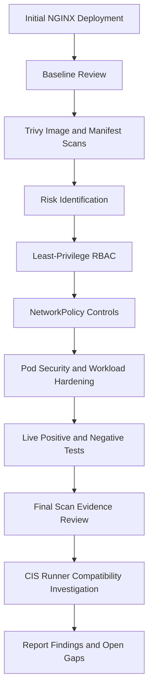
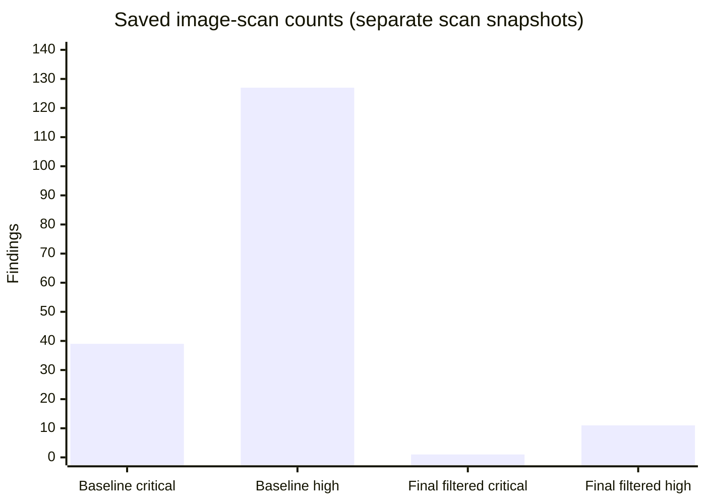
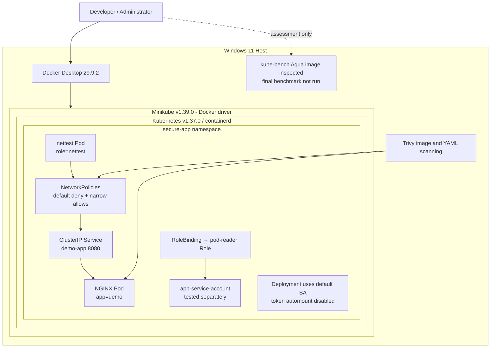

# Container Security and Kubernetes Hardening
## Securing a Modern Orchestration Platform

| Project information | Details |
|---|---|
| **Name of Student** | [Insert student name] |
| **Name of the Company** | [Insert company name] |
| **Name of the Institute** | [Insert institute name] |
| **Start Date** | 4 October 2026 |
| **End Date** | 12 November 2026 |
| **Total Effort (Hours)** | [Enter actual hours spent] |
| **Project Environment** | Windows 11, Docker Desktop, Minikube, Kubernetes |
| **Tools Used** | Docker Desktop, Minikube, Kubernetes, kubectl, Trivy, official Aqua kube-bench container (profile investigated; benchmark not run), Git, GitHub |

> **Submission note:** Complete the student, company, institute, and actual effort fields before submitting. They are intentionally left as placeholders because those details were not provided.

<!-- PAGEBREAK -->

## Table of Contents

1. [Acknowledgements](#1-acknowledgements)
2. [Objective and Scope](#2-objective-and-scope)
3. [Problem Statement](#3-problem-statement)
4. [Existing Approaches](#4-existing-approaches)
5. [Approach / Methodology - Tools and Technologies Used](#5-approach--methodology---tools-and-technologies-used)
6. [Workflow](#6-workflow)
7. [Assumptions](#7-assumptions)
8. [Implementation](#8-implementation)
9. [Solution Design](#9-solution-design)
10. [Challenges and Opportunities](#10-challenges-and-opportunities)
11. [Reflections on the Project](#11-reflections-on-the-project)
12. [Recommendations](#12-recommendations)
13. [Outcome / Conclusion](#13-outcome--conclusion)
14. [Enhancement Scope](#14-enhancement-scope)
15. [Link to Code and Executable File](#15-link-to-code-and-executable-file)
16. [Research Questions and Responses](#16-research-questions-and-responses)
17. [References](#17-references)

<!-- PAGEBREAK -->

## 1. Acknowledgements

I would like to thank the institute and internship organizers for providing the opportunity to work on an industry-oriented project in container and Kubernetes security. The project helped me connect security concepts with practical configuration and testing in a working Kubernetes environment.

I am grateful to the mentors, instructors, and peers who offered guidance, feedback, and encouragement during the project. I also acknowledge the maintainers of Kubernetes, Minikube, Trivy, and kube-bench for their technical documentation, which supported the implementation and assessment work.

## 2. Objective and Scope

Kubernetes coordinates containerized applications across a cluster. Its flexibility also means that insecure permissions, network rules, images, or workload settings can increase the impact of a compromised application. This project applies and tests several controls around a sample NGINX application in a local Minikube cluster.

The objectives were to:

- Compare an intentionally basic NGINX Deployment with a hardened version.
- Use Trivy evidence to assess image and Kubernetes manifest risks.
- Apply namespace-scoped least-privilege RBAC and test allowed and denied actions.
- Restrict pod communication with NetworkPolicies and test allowed and denied traffic.
- Configure workload security settings and namespace Pod Security Standards audit and warning labels.
- Review the retained kube-bench baseline and investigate a safe, supported way to obtain a final audit.
- Record results and limitations without claiming checks that were not completed.

The scope is a single-node local Minikube cluster, not a production or managed Kubernetes deployment. The project covers workload and namespace controls, selected image/configuration scans, and benchmark evidence review. It does not change host or control-plane configuration, introduce cloud-provider identity controls, establish centralized monitoring, or claim full CIS compliance.

## 3. Problem Statement

An application deployed with default or incomplete Kubernetes settings may inherit risks from both its image and the cluster configuration. A service account with unnecessary permissions can read or change resources beyond its task. Unrestricted pod networking may allow a compromised workload to communicate laterally. Running as root, allowing privilege escalation, retaining Linux capabilities, or using a writable root filesystem can increase the consequences of a container compromise. Missing resource limits can also allow one workload to consume more than its intended share of node resources.

The original project Deployment uses `nginx:1.16`, listens on container port 80, and does not specify the runtime security controls added to the hardened Deployment. The saved Trivy baseline reports 362 image findings and the original manifest scan reports 18 misconfiguration failures. These are historical scan results; their databases and timestamps are not guaranteed to match the later scan snapshots.

The assessment therefore addresses three connected questions: which controls can be configured at the workload/namespace layer, whether their intended runtime behavior can be demonstrated, and which remaining risks require a different image or a supported node-level audit environment.

## 4. Existing Approaches

**Role-Based Access Control (RBAC)** maps identities to permitted Kubernetes API actions. A namespace-scoped Role limits the scope of a permission grant; a RoleBinding attaches the Role to a user, group, or ServiceAccount. The project uses this approach to grant read-only Pod access and checks that deletion is denied.

**NetworkPolicies** select Pods and allow ingress and/or egress traffic by peer and port. Policies are additive, and a policy object has no effect unless the cluster network plugin enforces it. The project establishes ingress isolation and adds narrow exceptions for DNS and the test client.

**Pod Security Standards (PSS)** define cumulative Privileged, Baseline, and Restricted profiles. Privileged is broadly permissive, Baseline blocks known privilege escalations while remaining more compatible, and Restricted applies stronger workload hardening requirements. The project configures Restricted audit and warning labels for its namespace, but does not enable enforcement.

**Container image scanning** compares packages found in an image against vulnerability information. Trivy was used to scan the original image, the pinned hardened image, and Kubernetes YAML. A digest pin improves reproducibility but does not remediate vulnerabilities in the image.

**The CIS Kubernetes Benchmark** provides configuration checks for Kubernetes components and cluster controls. kube-bench automates checks where it can access the required node configuration and processes. A trustworthy result depends on using a benchmark profile compatible with the Kubernetes version and providing the required node access. The project preserves a baseline and investigated the official runner; it did not produce a final CIS check result for Kubernetes 1.37.

## 5. Approach / Methodology - Tools and Technologies Used

| Tool / technology | Purpose | Use in this project |
|---|---|---|
| Windows 11 | Host operating system | Project and local cluster administration environment. Reported host build: 10.0.26200.9711. |
| Docker Desktop | Local container engine | Minikube Docker driver and local execution of the official kube-bench image for harmless version/help/profile inspection. |
| Minikube | Local Kubernetes distribution | Single-node cluster. Version 1.39.0; Docker driver; containerd runtime. |
| Kubernetes / kubectl | Workload orchestration and cluster API | Applied/inspected manifests, checked authorization, and observed workload and Service state. Client v1.37.2; server v1.37.0. |
| Trivy | Image and IaC security scanner | Saved reports cover the baseline image, hardened image, workload manifests, NetworkPolicies, and test Pod. Version 0.76.2 was recorded. |
| kube-bench | CIS benchmark runner | Baseline files were reviewed. Official Aqua image v0.16.0 was pulled and inspected. No final benchmark checks were run because the shipped profiles do not support Kubernetes 1.37 and its official node Job requires sensitive access that was not approved. |
| Git / GitHub | Version control and source sharing | Repository contains manifests, scan evidence, remediation log, and reports. |

### Method stages

1. Establish repository scope and identify the active local environment.
2. Review original workload, saved scans, and baseline evidence.
3. Identify image, permission, network, and runtime risks.
4. Implement least-privilege RBAC, network segmentation, and workload security settings.
5. Validate live RBAC and network behavior with positive and negative tests.
6. Compare saved baseline and hardened scan evidence, noting different scan snapshots.
7. Investigate kube-bench using official Aqua documentation and image only.
8. Record outcomes, blockers, and future work in the project documentation.

## 6. Workflow

The project followed the sequence below. A final kube-bench comparison was attempted as an investigation, but the final benchmark itself remains not run.



**Figure 1.** Project workflow from initial deployment through validation and evidence-based reporting.

## 7. Assumptions

- The working environment is Windows 11 with Docker Desktop, as identified for this project. The observed Windows build is 10.0.26200.9711.
- Minikube is a local, single-node cluster used for educational testing, not production.
- NGINX is a sample workload for demonstrating security controls; it is not a business application.
- Image pulls and vulnerability database updates may require Internet access.
- NetworkPolicy results depend on CNI enforcement. Calico was observed in the active cluster, and live traffic tests confirmed enforcement for the tested rules.
- Some CIS checks are node/control-plane-specific and may not map to a Minikube node.
- Company name, institute name, student name, and time spent are not present in the repository and must be supplied by the student.

## 8. Implementation

### 8.1 Environment Setup

The observed tool and cluster versions were collected during the project. Docker Desktop 29.9.2 was running its Linux engine. Minikube 1.39.0 was running with the Docker driver and containerd. The cluster server reported Kubernetes v1.37.0 and the kubectl client v1.37.2. The node reported Debian GNU/Linux 12. Trivy 0.76.2 was installed on the host.

The active kubectl context was `minikube`. The cluster included the `secure-app` namespace and a running `demo-app` Deployment. The Calico node DaemonSet was present in `kube-system`.

### 8.2 Initial Deployment and Baseline Assessment

The baseline manifest (`manifests/workloads/00-demo-original.yaml`) declares a single `demo-app` replica using `nginx:1.16` and container port 80. It is intentionally retained to preserve the starting point; it should not be applied alongside the hardened Deployment because both share the same Deployment name.

The saved baseline Trivy image report for `nginx:1.16` reports 362 findings: 39 Critical, 127 High, 149 Medium, 38 Low, and 9 Unknown. The baseline manifest scan reports 18 failures among 99 tests: 3 High, 4 Medium, and 11 Low. The failures include missing privilege-escalation protection, missing capability drops, absent resource limits, and root/security-context controls.

The kube-bench baseline file reports 56 PASS, 14 FAIL, 61 WARN, and 21 INFO. The historical files do not record the kube-bench release or benchmark profile. These results are preserved as baseline evidence only; they are not final results for the current cluster.

### 8.3 Container Image Security

Container image vulnerabilities are known weaknesses in operating-system packages or application libraries included in an image. Trivy compares detected packages with its vulnerability database and reports severity and, when available, a fixed package version. HIGH and CRITICAL findings deserve prompt review, but severity alone does not determine exploitability in the specific application context.

The hardened Deployment replaces the old baseline reference with the digest-pinned image:

```text
docker.io/nginxinc/nginx-unprivileged:mainline-alpine@sha256:b5047b9b76845eac124358373c6852377c52e4b05834a47647e955dd91cb8f1e
```

The unprivileged variant is a better runtime starting point, and the digest makes the selected image content reproducible. It does not make the image vulnerability-free.

#### Scan evidence

The saved severity-filtered `scans/trivy/image-final.txt` reports 12 HIGH/CRITICAL findings (11 High and 1 Critical). The saved JSON file `scans/trivy/image-final.json` is a broader snapshot reporting 57 findings (1 Critical, 9 High, 3 Medium, 44 Low). These two final artifacts have inconsistent HIGH counts and should not be treated as a single scan result. A fresh paired full and filtered scan is recommended before the final academic submission. The values below are kept separate to avoid hiding the discrepancy.

| Evidence file | Scan scope | Recorded result |
|---|---|---|
| `scans/trivy/image-baseline.txt` | Original `nginx:1.16` | 362 total: 39 Critical, 127 High, 149 Medium, 38 Low, 9 Unknown |
| `scans/trivy/image-final.txt` | Final pinned image; HIGH/CRITICAL-filtered text output | 12: 1 Critical, 11 High |
| `scans/trivy/image-final.json` | Final pinned image; full JSON snapshot | 57: 1 Critical, 9 High, 3 Medium, 44 Low |



**Figure 2.** Counts in the retained baseline text report and final HIGH/CRITICAL-filtered text report. These snapshots are not guaranteed to be directly comparable because their scan scope and database context may differ.

The following CVEs and package versions appear in the saved full JSON report. Repeated CVEs can affect more than one package, so unique CVE counts and package-level finding counts may differ.

| CVE | Severity | Package(s) | Installed → fixed version | Finding summary |
|---|---|---|---|---|
| CVE-2026-111497 | Critical | brotli-libs | 1.2.0-r1 → 1.2.1-r0 | Out-of-bounds write in Brotli decoder |
| CVE-2026-92392 | High | curl, libcurl | 8.22.0-r0 → 8.23.0-r0 | HTTP/2 upload use-after-free |
| CVE-2026-113351 | High | libexpat | 2.9.0-r0 → 2.10.0-r0 | Denial of service during parser reset |
| CVE-2026-115506 | High | libexpat | 2.9.0-r0 → 2.10.0-r0 | Denial of service via delayed entity amplification detection |
| CVE-2026-117610 | High | libexpat | 2.9.0-r0 → 2.10.0-r0 | Denial of service in external entity parsing |
| CVE-2026-118370 | High | libexpat | 2.9.0-r0 → 2.10.0-r0 | Denial of service during XML attribute parsing |
| CVE-2026-107891 | High | musl, musl-utils | 1.2.6-r2 → 1.2.6-r3 | Integer overflow in `regcomp` |
| CVE-2026-85091 | High | zlib | 1.3.2-r0 → 1.3.2-r1 | Heap buffer overflow in `gz_vacate()` |

These are unresolved in the saved final evidence. The recommended action is to select a maintained image digest whose updated package set addresses the fixed-version gaps, then rerun both full and severity-filtered scans from the same database snapshot. The report does not claim that a patch was applied to the image.

The saved hardened-manifest scan (`scans/trivy/config-final.txt`) reports 37 successes and one Medium failure, KSV-0125, because the scanner policy does not recognize the image registry as trusted. The network policy scan reports zero misconfigurations. These are scanner findings, not proof by themselves of every runtime property.

### 8.4 RBAC Implementation

Kubernetes RBAC controls which API operations an identity can perform. The repository defines a ServiceAccount named `app-service-account`, a namespace-scoped Role named `pod-reader`, and a RoleBinding named `read-pods-binding` in `secure-app`. The Role permits `get`, `list`, and `watch` on Pods only. It grants no Pod deletion or cluster-wide permissions.

The real authorization checks used impersonation:

```cmd
kubectl auth can-i get pods --as=system:serviceaccount:secure-app:app-service-account -n secure-app
kubectl auth can-i delete pods --as=system:serviceaccount:secure-app:app-service-account -n secure-app
kubectl auth can-i get pods --as=system:serviceaccount:secure-app:default -n secure-app
```

Actual output:

```text
yes
no
no
```

The app ServiceAccount can read Pods but cannot delete them; the default ServiceAccount cannot read Pods under this Role. The Deployment manifest does not set `serviceAccountName`, so Kubernetes assigns the namespace's default ServiceAccount to that Pod. The hardened Deployment also sets `automountServiceAccountToken: false`. Therefore, the `app-service-account` authorization test verifies the RoleBinding in isolation; it does not demonstrate that the running NGINX Pod uses that ServiceAccount. This is intentionally called out rather than implying the Role is attached to the application.

### 8.5 NetworkPolicy Implementation

Kubernetes NetworkPolicies define permitted layer-3/4 traffic for selected Pods. They rely on an enforcing network plugin. Calico was present in the cluster and the traffic test confirmed that the configured policy was enforced.

The policies in `manifests/network-policies/` work together:

- `01-default-deny.yaml` isolates all namespace Pods from ingress.
- `02-allow-dns.yaml` allows UDP/TCP port 53 egress to Pods in `kube-system`.
- `03-allow-demo-ingress.yaml` allows TCP 8080 ingress to `app=demo` Pods from `role=nettest` Pods in the same namespace.
- `04-allow-nettest-egress.yaml` allows selected `role=nettest` Pods to reach `app=demo` Pods on TCP 8080.

The labeled test Pod successfully fetched the NGINX page from `http://demo-app:8080`. After the `role=nettest` label was removed, the same request timed out and exited with code 1. The test Pod was deleted after the test. This supplies both a positive and negative traffic test. DNS is allowed by the policy design, but a separate `nslookup`/DNS-resolution output is not recorded; that behavior is therefore not marked as separately tested.

### 8.6 Pod Security Standards

PSS profiles are cumulative:

- **Privileged**: least restrictive and suitable only for trusted system-level workloads requiring broad permissions.
- **Baseline**: prevents common privilege escalations while retaining more workload compatibility.
- **Restricted**: applies stronger hardening requirements, including non-root execution and tighter capability and seccomp controls.

The `secure-app` namespace manifest configures `pod-security.kubernetes.io/audit=restricted` and `pod-security.kubernetes.io/warn=restricted`. It does not set `pod-security.kubernetes.io/enforce`. Enforcement is intentionally withheld; the repository does not include captured server-side dry-run warnings or a recorded review of all namespace workloads under enforcement.

The hardened Deployment and `nettest` Pod declare settings consistent with key Restricted controls, including non-root UIDs/GIDs, `RuntimeDefault` seccomp, dropped capabilities, and disabled privilege escalation. This is evidence of manifest configuration, not a recorded proof that namespace enforcement was enabled.

### 8.7 Workload Hardening

The hardened Deployment uses the following controls:

| Control | Configuration | Security purpose |
|---|---|---|
| Non-root identity | `runAsNonRoot: true`, UID/GID 10001, `fsGroup: 10001` | Limits privileges available inside the container. |
| Seccomp | `RuntimeDefault` | Uses the container runtime's default syscall filter. |
| Privilege escalation | `allowPrivilegeEscalation: false` | Prevents a process from gaining additional privileges through execution. |
| Linux capabilities | Drops `ALL` | Removes ambient kernel privileges unless explicitly required. |
| Root filesystem | `readOnlyRootFilesystem: true` | Prevents writes to the container image filesystem; `/tmp` is a bounded `emptyDir`. |
| Resource controls | Requests: 100m CPU/128Mi memory; limits: 200m CPU/256Mi memory | Reserves and caps resources for the container. |
| Health | HTTP readiness and liveness probes on named `http` port | Reports whether the app is ready and whether it should be restarted. |
| Service account token | Pod-level `automountServiceAccountToken: false` | Avoids mounting an API token when the app does not need it. |
| Image reference | Explicit registry and immutable digest | Makes image content reproducible; does not eliminate CVEs. |

The Pod ran as Ready in the cluster and the Service had an endpoint at the time of collection. The exact captured state is in `reports/validation-evidence.md`.

### 8.8 Validation and Evidence

| Test | Expected | Actual evidence | Status |
|---|---|---|---|
| Demo Pod and Service | Pod Ready and Service has endpoint | `demo-app` showed `1/1 Running`; Service endpoint was recorded as `10.244.120.93:8080` | Pass |
| RBAC read | App ServiceAccount can get Pods | `kubectl auth can-i` returned `yes` | Pass |
| RBAC delete | App ServiceAccount cannot delete Pods | `kubectl auth can-i` returned `no` | Pass |
| Default SA read | Default ServiceAccount cannot get Pods under this Role | `kubectl auth can-i` returned `no` | Pass |
| Network allow | Labeled test Pod can reach the app | `wget` returned the NGINX HTML page | Pass |
| Network deny | Unlabeled client cannot reach the app | `wget` timed out; command exited 1 | Pass |
| NetworkPolicy scan | No reported policy misconfiguration | Saved Trivy output reports zero | Pass for scan only |
| Hardened manifest scan | No misconfiguration findings | One Medium KSV-0125 remains | Partial |
| Image scan | No High/Critical findings | Findings remain; TXT and JSON snapshots disagree on High count | Not passed |
| PSS enforcement | Restricted enforcement active | Audit/warn only; enforce not configured | Not enabled |
| Final kube-bench | Compatible CIS check results recorded | No checks run for Kubernetes 1.37 | Not run |

## 9. Solution Design

The diagram distinguishes the live workload from assessment tools. Trivy runs from the host against image and manifest inputs. kube-bench was investigated but not run against the active cluster. The RoleBinding's ServiceAccount is separate from the Deployment's default ServiceAccount because the Deployment does not set `serviceAccountName`.



**Figure 3.** Project architecture for the local cluster and its evidence collection. The dashed kube-bench connection represents investigation only, not a completed audit.

## 10. Challenges and Opportunities

| Challenge | How it was addressed | Remaining opportunity |
|---|---|---|
| Mapping policy selectors to actual Pod labels and ports | Compared the policy selectors with `app=demo`, `role=nettest`, and TCP 8080; performed allowed and denied tests. | Retain automated regression tests for label and port changes. |
| Knowing whether NetworkPolicies are enforced | Confirmed Calico was present, then tested both successful and blocked requests. | Add a separate DNS resolution test and collect its output. |
| Interpreting image scan output | Preserved baseline and final reports; recorded exact CVEs, packages, and fixed versions from the saved JSON. | Re-run full and filtered Trivy scans together because the final TXT/JSON artifacts disagree on High counts. |
| Understanding digest pinning | Kept the image immutable for reproducibility and treated vulnerability remediation as a separate task. | Select an updated digest and verify it with a new scan before rollout. |
| Testing RBAC in context | Used `kubectl auth can-i` with explicit identities and resource actions. | If application API access is ever required, set `serviceAccountName` explicitly and test the running Pod identity. |
| Running kube-bench from Windows | Checked Docker and Minikube, ran the official Aqua image harmlessly for version/help, inspected its profiles and official Job. | Wait for an official Kubernetes 1.37 profile and obtain approval before granting host PID/path access. |
| Avoiding overclaiming | Recorded PSS as audit/warn, not enforce; recorded no final CIS result. | Complete those checks only when evidence and a compatible environment are available. |

## 11. Reflections on the Project

While working on this project, I learned that Kubernetes security is not a single setting. It depends on several controls agreeing with one another: identity, Pod labels, ports, network policy directions, and container runtime settings all need to match.

The most useful practical lesson was to test behavior, not just inspect YAML. The Role and RoleBinding were easier to understand after checking an allowed read and a denied delete. Likewise, the NetworkPolicy test became meaningful only after observing both a successful request from the labeled client and a timeout after removing the selector label.

The image work also showed me that a digest is useful for reproducibility but is not a security guarantee. A non-root image can still include vulnerable packages. I also learned to compare scan artifacts carefully: the text and JSON final reports in the repository do not agree on the High finding count, so they should be regenerated as a paired set rather than blended into one conclusion.

Finally, the kube-bench investigation helped me understand that running an audit tool can require access to node files and processes. A tool being available as a container image is not enough; the profile must match the cluster version, and the required privileges and mounts must be understood before execution.

## 12. Recommendations

The following recommendations extend beyond what is currently verified:

1. **Resolve image findings:** Select a maintained image digest with updated Alpine packages and rerun full and HIGH/CRITICAL Trivy scans in the same session. Keep the paired outputs and database context together.
2. **Establish trusted image sources:** Define an approved registry policy, verify the expected registry in Trivy configuration, and investigate KSV-0125 rather than suppressing it without review.
3. **Keep RBAC minimal:** Review RoleBindings periodically. If an application needs Kubernetes API access, assign its ServiceAccount explicitly and validate actual runtime identity.
4. **Preserve network isolation:** Keep default-deny policies and narrow allow rules. Add tests for DNS, unexpected egress, and selector changes.
5. **Use PSS carefully:** Review audit and warning output for every workload before considering Restricted enforcement. Make enforcement a deliberate, separately approved change.
6. **Run regular CIS assessments:** Use an official kube-bench profile documented for the cluster version. Review required privileges and mounts before running node-level checks; report N/A only when supported by evidence.
7. **Add operational controls:** For a production deployment, add centralized audit logging, monitoring, alerting, and a secure secrets-management process.
8. **Automate verification:** Add manifest validation, image scanning, and policy regression checks to a CI/CD workflow, with thresholds that fail builds when agreed risk criteria are exceeded.

## 13. Outcome / Conclusion

The project retained an intentionally basic baseline and added a digest-pinned, non-root NGINX workload with restricted runtime settings, a namespace-scoped Pod-reader Role, and NetworkPolicies. Live evidence demonstrated that the app Service was backed by a running Pod, the designated client could access the application, an unlabeled client was blocked, and the tested ServiceAccount could read but not delete Pods.

The available scan evidence shows substantial improvement in the configuration baseline but does not show a clean image. The final image text scan reports 1 Critical and 11 High findings; the JSON scan snapshot reports 1 Critical, 9 High, 3 Medium, and 44 Low findings. Because those snapshots disagree, a paired rescan is needed before using a single final count. Trivy also reports the Medium KSV-0125 registry-trust finding.

The CIS baseline is preserved, but a final kube-bench benchmark was not run. The official Aqua image release inspected does not include a profile for Kubernetes 1.37, and the official node Job requires host PID visibility and read-only mounts of sensitive node paths. The project therefore demonstrates practical workload and namespace hardening without claiming full CIS compliance or complete security.

## 14. Enhancement Scope

Future work could extend this lab by:

- Repeating the assessment on a disposable Kubernetes version explicitly supported by the selected official kube-bench release, while keeping its results separate from the current cluster.
- Re-running the current cluster audit when an official profile for Kubernetes 1.37 is available and the Job's access is approved.
- Updating the image to a patched digest and generating matching full and filtered scan outputs.
- Integrating Trivy and manifest tests into CI/CD.
- Adding automated admission controls for trusted image registries and Pod Security.
- Adding runtime threat detection, central logging, and alerting.
- Integrating a dedicated secrets-management solution.
- Expanding negative connectivity and RBAC tests into repeatable automated regression tests.

These items are proposed enhancements, not completed project work.

## 15. Link to Code and Executable File

**GitHub repository:** [https://github.com/CodageWithRahul/k8s-container-security-hardening](https://github.com/CodageWithRahul/k8s-container-security-hardening)

The repository is a Kubernetes configuration and security assessment project. It does not include a standalone application executable. To reproduce the workload in an appropriate local Minikube environment, review the README and apply the namespace, RBAC, numbered NetworkPolicy, hardened Deployment, and Service manifests in the documented order. Do not apply the historical `00-cluster-export-evidence.yaml` file.

The project contains local evidence and reports under `scans/`, `reports/`, and `logs/`. Reproducing saved results may require newer image and vulnerability database snapshots, so newly generated output should be labeled with its collection date and tool version.

## 16. Research Questions and Responses

### 16.1 How can Kubernetes RBAC reduce unauthorized access?

RBAC maps an identity to a specific set of API verbs and resources. In this project, the `pod-reader` Role is limited to `get`, `list`, and `watch` on Pods in `secure-app`. The recorded check returned `yes` for `get pods` and `no` for `delete pods` for `app-service-account`, demonstrating that read access does not imply destructive access.

### 16.2 How can NetworkPolicies restrict unwanted Pod-to-Pod communication?

Policies select source and destination Pods and permit only specified directions, ports, and peers. Here, all namespace Pods are ingress-isolated, DNS is allowed on TCP/UDP 53 to `kube-system`, and the labeled `nettest` client is permitted to reach `app=demo` on TCP 8080. Live tests returned the NGINX page for the labeled client and timed out after its role label was removed.

### 16.3 How does Trivy help identify container image vulnerabilities?

Trivy inventories packages in an image and matches them with its vulnerability database. The saved baseline report identifies 362 findings in `nginx:1.16`. The hardened image scan reports remaining Critical and High findings and names affected packages and fixed versions. The differing final text/JSON counts show why scan scope and report timestamps must be preserved together.

### 16.4 How do Pod Security Standards improve workload security?

PSS provides progressively stronger admission profiles. Restricted is intended for workloads that can satisfy stronger non-root, capability, and seccomp requirements. The namespace has Restricted audit and warn labels, and the workload manifests declare several corresponding controls. Enforcement was not enabled, so the project does not claim an enforced Restricted profile.

### 16.5 How can kube-bench help evaluate Kubernetes configuration against CIS recommendations?

kube-bench executes automated checks derived from supported CIS benchmark profiles and can report PASS, FAIL, WARN, and INFO. Its node-level checks may need access to host configuration and processes. This project preserves baseline counts and tested the official Aqua container, but no final checks were run because the inspected release does not support Kubernetes 1.37 and the official Job's sensitive node access was not approved.

### 16.6 What limitations arise when assessing a local Minikube environment?

Minikube is a single-node learning environment with a specific node filesystem and component layout. Some generic CIS checks may not map to it, and results do not represent a production cluster. The observed node lacked `/etc/kubernetes/pki`, and `kubelet` was not found in its command path. CNI enforcement also must be verified, which was done for the tested Calico network rules.

## 17. References

1. Kubernetes, **Role-Based Access Control (RBAC)**. https://kubernetes.io/docs/reference/access-authn-authz/rbac/
2. Kubernetes, **Network Policies**. https://kubernetes.io/docs/concepts/services-networking/network-policies/
3. Kubernetes, **Pod Security Standards**. https://kubernetes.io/docs/concepts/security/pod-security-standards/
4. Kubernetes, **Configure a Security Context for a Pod or Container**. https://kubernetes.io/docs/tasks/configure-pod-container/security-context/
5. Aqua Security, **Trivy: Container Image**. https://trivy.dev/latest/docs/target/container_image/
6. Aqua Security, **Trivy: Kubernetes Configuration**. https://trivy.dev/latest/docs/coverage/iac/kubernetes/
7. Aqua Security, **kube-bench repository and running guide**. https://github.com/aquasecurity/kube-bench
8. Aqua Security, **kube-bench v0.16.0 Kubernetes benchmark support matrix**. https://github.com/aquasecurity/kube-bench/blob/v0.16.0/docs/platforms.md
9. Aqua Security, **kube-bench v0.16.0 running guide**. https://github.com/aquasecurity/kube-bench/blob/v0.16.0/docs/running.md
10. Aqua Security, **kube-bench v0.16.0 Kubernetes Job**. https://github.com/aquasecurity/kube-bench/blob/v0.16.0/job.yaml
11. Minikube, **Start Minikube**. https://minikube.sigs.k8s.io/docs/start/
12. Center for Internet Security, **CIS Kubernetes Benchmark**. https://www.cisecurity.org/benchmark/kubernetes

**Repository evidence consulted:** `README.md`; `manifests/rbac/`; `manifests/network-policies/`; `manifests/workloads/`; `scans/trivy/`; `scans/kube-bench/`; `logs/remediation-log.md`; and the supporting reports in `reports/`.
